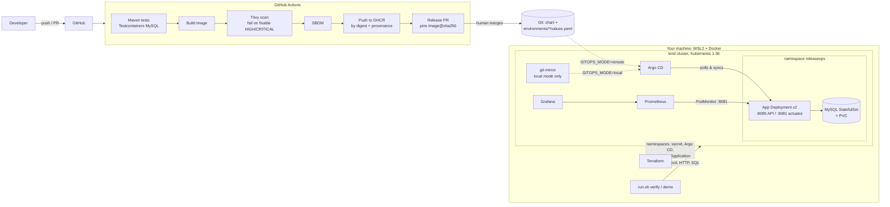

# ReleaseOps — reliable delivery, GitOps and release verification

A Kubernetes delivery pipeline built around the Crewmeister DevOps challenge application
(Spring Boot + MySQL + Flyway, `GET/POST /user`). It builds, scans, ships, deploys through **GitOps**, **verifies** that
a release really works, shows what happens when a release is **bad**, and recovers by reverting **Git**.

* Everything runs on a laptop: WSL2 + Docker + kind. No cloud account, no paid service.
* The original challenge text is kept in [docs/CHALLENGE.md](docs/CHALLENGE.md).
* This is an independent implementation of the Kubernetes variant of the task. It is **not** a description of
  Crewmeister's own infrastructure.

> **Honesty box.** Everything under *Actual results* was produced by running the commands in this repository on the
> author's machine. Things that were **not** run are listed under [Known limitations](#known-limitations) — notably
> the AWS/EKS code (validated offline only), the GitHub Actions workflows (written and statically checked, but not yet
> executed on GitHub because the repository was not published), and `GITOPS_MODE=remote` against a real GitHub repo.

---

## 1. Quick start

```bash
# WSL2 Ubuntu, Docker running, repository cloned inside WSL (e.g. ~/releaseops)
./run.sh up
```

`up` = doctor → kind cluster + local registry → Terraform (namespaces, secrets, Argo CD, Prometheus/Grafana) →
Maven tests → image build → Trivy scan → SBOM → push by digest → commit the digest to the GitOps source →
Argo CD syncs → **release verification** → monitoring check → report → access URLs.

Then: `./run.sh demo` (bad release + Git rollback) and `./run.sh status`.

### Five-minute reviewer guide
| Minute | Do | Look for |
|---|---|---|
| 0 | `./run.sh up` (**8 min** measured on a warm image cache; the very first run adds ≈10 min of downloads incl. the ≈3 GB scanner DB — start it before the clock) | `✔ RELEASE VERIFIED  … 12 passed`, then the URL list |
| 1 | `curl -s -X POST localhost:18080/user -H 'Content-Type: application/json' -d '{"name":"Ada"}' -i` then `curl -s 'localhost:18080/user?id=2'` | `Greetings from Crewmeister, Ada!` and a `Location: /user?id=2` header |
| 2 | Open Argo CD `http://localhost:18081` (password from `./run.sh status`) | Application `releaseops`: **Synced / Healthy**, source = the GitOps repo, image pinned by `@sha256:` |
| 3 | `./run.sh demo` (**≈3 min**; or read the recorded run in [docs/evidence/](docs/evidence/)) | drift reverted → bad commit pushed → **verification FAILS** with real diagnostics → the Prometheus alert **fires** → `git revert` → **verified again** → canary data still there |
| 4 | Open Grafana `http://localhost:13000` → *ReleaseOps – application and release health* | Replica/readiness dip during the demo, request rate, JVM, DB up |
| 5 | Read `reports/out/release-report.md` | One page of evidence: digest, tests, scan, SBOM, Argo state, every verification check |

---

## 2. Architecture



### Who owns what
| Layer | Created by | Notes |
|---|---|---|
| kind cluster + local registry | `scripts/cluster.sh` | Stage 0, outside Terraform on purpose (provider cycle) |
| Namespaces, DB Secret, Argo CD, Application/AppProject, kube-prometheus-stack, git mirror | **Terraform** (`infra/terraform/local`) | Static kubeconfig + pinned context |
| Everything the Helm chart renders in `releaseops` | **Argo CD** | Terraform never touches it |
| Image digest in `values.yaml` | CI release PR (remote) / `./run.sh deploy` (local) | Never edited by hand |

### Delivery lifecycle
1. **Commit** application or chart changes.
2. **CI** runs tests (real MySQL), validates Helm/Terraform/shell, builds the image, scans it, generates an SBOM.
3. On `main`: the *exact scanned image* is pushed to GHCR, its **digest** is captured and provenance is attested.
4. CI opens a **release pull request** pinning `image@sha256:…`. A human merges it — that merge is the deploy decision.
5. **Argo CD** sees the new desired state and reconciles (auto-sync, prune, self-heal).
6. **Release verification** (`verify.sh`) proves the release works — Argo's "Healthy" is necessary, not sufficient.
7. Bad release? **Revert the Git commit**; Argo CD reconciles back; verify again.

Locally, steps 2–4 are done by `./run.sh deploy` against the same chart and the same verification (the image goes to a
local registry and the digest is committed to the git source Argo CD watches).

More: [ADR index](#architecture-decision-records) · [versions & sources](docs/VERSIONS.md).

---

## 3. Repository layout

```
Dockerfile, .dockerignore          multi-stage, non-root, digest-pinned bases
pom.xml, src/                      the original app (+ tests, Prometheus registry, probes)
deploy/helm/releaseops/            the chart: app, MySQL, probes, NetworkPolicy, PodMonitor, alerts, dashboard
deploy/environments/local/         values Argo CD applies (image digest lives here)
deploy/environments/aws/           same chart, AWS settings (unprovisioned)
infra/terraform/local/             Terraform for the kind cluster (+ modules/*)
infra/terraform/aws/               OPTIONAL EKS/ECR/OIDC — validated offline, never applied
scripts/                           cluster, infra, release, verify, demo, report, doctor, status, monitor-check
.github/workflows/                 ci.yml (+ manual aws-plan.yml), dependabot.yml
docs/adr/                          architecture decision records
docs/evidence/                     the recorded results of the clean-room run (report, verification JSON, demo, SBOM)
docs/VERSIONS.md                   version choices and sources
tools/gen_dashboard.py             generates the Grafana dashboard JSON shipped in the chart
reports/out/                       evidence generated on YOUR machine (git-ignored)
run.sh, Makefile                   the CLI (Makefile is a thin wrapper)
```

---

## 4. Prerequisites (WSL2 Ubuntu)

| Needs | How |
|---|---|
| WSL2 + an Ubuntu distro, ≥ 6 GiB RAM visible to Docker (the whole stack measured **4.3 GiB**) | `.wslconfig`: `[wsl2] memory=8GB` |
| Docker reachable from the distro | Docker Desktop with *Settings → Resources → WSL integration → your distro* **or** Docker Engine in WSL |
| `git curl jq tar make unzip` | `sudo apt-get update && sudo apt-get install -y git curl jq make unzip` |
| Java 17 (only for the Maven test stage) | `sudo apt-get install -y openjdk-17-jdk-headless`; or `SKIP_TESTS=1 ./run.sh up` (recorded as *skipped* in the report) |
| `kind kubectl helm terraform` | `./run.sh tools` — installs missing ones into `~/.local/bin`, **no sudo**, checksums verified |

`./run.sh doctor` checks all of this (read-only) and prints the exact fix for anything missing.
Clone the repo **inside the WSL filesystem** (`~/…`), not under `/mnt/c`: it is much faster and avoids CRLF problems (all results below come from a WSL-native working copy; running from `/mnt/c` was not tested).

---

## 5. Commands

| Command | What it does |
|---|---|
| `./run.sh up` | Everything, end to end (idempotent: safe to re-run) |
| `./run.sh doctor` | Prerequisite and environment checks |
| `./run.sh setup` | Cluster + Terraform + Argo CD + monitoring (no release) |
| `./run.sh deploy` | test → build → scan → SBOM → push → commit digest → Argo CD syncs |
| `./run.sh verify [--wait N]` | End-to-end release verification; exit code 1 on failure |
| `./run.sh demo [--skip-drift]` | Drift + bad release + Git rollback demonstration |
| `./run.sh status` | State of Argo CD / app / monitoring and access URLs + credentials |
| `./run.sh monitor` | Executes every dashboard query against Prometheus; checks alerts and the Grafana import |
| `./run.sh logs [app\|mysql\|argocd]` | Follow logs |
| `./run.sh report` | Build `reports/out/release-report.{json,md}` |
| `./run.sh validate` | Offline: helm lint/template, terraform fmt/validate (local + AWS), shell syntax |
| `./run.sh cleanup [--yes] [--keep-cache]` | Delete **only** this project's cluster, registry and state (`--keep-cache` keeps the ≈3 GB scanner DB volume) |

`make <target>` calls the same thing. Configuration via environment variables (ports, names, `GITOPS_MODE`, …) is
documented in `scripts/lib/common.sh`.

### Safety rules the scripts follow
* A **dedicated kubeconfig** (`.releaseops/kubeconfig`) and a pinned context: `~/.kube/config` is never read or written,
  and `kubectl` can never hit another cluster by accident.
* Only resources named `releaseops*` (cluster, registry container, a Trivy cache volume) are created or deleted. Your other
  containers, volumes and clusters are never touched. `cleanup` prints exactly what it will remove and asks first.
* Everything listens on `127.0.0.1` only.

---

## 6. Using the application

The API is the one in the challenge; behaviour is unchanged except the small, documented items in
[ADR-0002](docs/adr/0002-spring-boot-upgrade.md).

| Request | Response |
|---|---|
| `POST /user` `{"name":"Ada"}` | `200`, body `Greetings from Crewmeister, Ada!`, header `Location: /user?id=<id>` |
| `GET /user?id=1` | `200`, `Greetings from Crewmeister, Alice!` (row seeded by Flyway) |
| `GET /user?id=999999` | `404` (was `500`) |
| `GET /user` (no id) | `400` |
| `POST /user` with invalid JSON | `200` `Error parsing JSON` — legacy behaviour, kept and pinned by a test |

```bash
curl -si -X POST localhost:18080/user -H 'Content-Type: application/json' -d '{"name":"Ada"}'
curl -s 'localhost:18080/user?id=1'
```

Run the app without Kubernetes: start a MySQL, then `./mvnw spring-boot:run` (defaults to `root/dev@localhost:3306`).

---

## 7. Access

`./run.sh status` prints the URLs **and** the generated passwords.

| What | URL | Login |
|---|---|---|
| API | http://localhost:18080 | – |
| Argo CD | http://localhost:18081 | `admin` / initial password from the `argocd-initial-admin-secret` (printed by `status`) |
| Grafana | http://localhost:13000 | `admin` / random password generated by Terraform (printed by `status`) |
| Prometheus | http://localhost:19090 | – |
| kubectl | `export KUBECONFIG=$PWD/.releaseops/kubeconfig` and use `--context kind-releaseops` | – |

UIs run over plain HTTP bound to `127.0.0.1` (TLS has no value on loopback). Do not expose these ports.

---

## 8. Terraform design

See [ADR-0004](docs/adr/0004-terraform-boundaries.md). In short:

* **Staged**: shell creates the cluster → Terraform connects by static kubeconfig path/context → manages namespaces,
  Secret, Argo CD, monitoring and the Argo `Application` → Argo CD manages the app. No provider depends on a resource of
  the same configuration; the `Application` is installed via a small Helm chart so a first `apply` needs no CRDs at plan time.
* **No overlap**: Terraform never renders the app chart; Argo CD can not create namespaces or cluster-scoped objects
  (`AppProject` whitelist is empty) and never sees the DB Secret's value.
* **Pinned**: providers `~> 3.3.0` (+ committed `.terraform.lock.hcl`, five platforms), chart versions as variables,
  `required_version >= 1.14`.
* **State**: local file in the git-ignored `.releaseops/` with mode 0600 — it holds generated passwords, so it is a
  secret. Use a remote encrypted, locked backend for anything shared (the AWS root shows the S3 block).
* `terraform fmt -check` and `validate` run in CI for both roots; no `local-exec` provisioners are used.

---

## 9. CI pipeline (`.github/workflows/ci.yml`)

| Job | Runs on | Does |
|---|---|---|
| `test` | PR + main | `./mvnw verify` with real MySQL (Testcontainers); uploads surefire reports |
| `validate` | PR + main | `helm lint --strict` + render, `terraform fmt/validate` for local and AWS, `bash -n`, `shellcheck` |
| `image` | PR + main | Build → **Trivy** (fail on fixable HIGH/CRITICAL) → **SBOM (Syft/SPDX)** → on `main` only: push the *same* image to GHCR, capture digest, sign provenance |
| `release-pr` | main only | Pins `image@sha256:…` in `deploy/environments/local/values.yaml` and opens a **pull request** |

Security properties: `permissions: {}` at the top and per-job grants; triggers are `pull_request` (never
`pull_request_target`) so fork code gets no token or secrets; the registry login/push/attest steps and the PR job are
`main`-only; no stored cloud keys (the optional AWS workflow uses GitHub OIDC, plan-only, manual); third-party
Actions pinned by **commit SHA** (see [VERSIONS.md](docs/VERSIONS.md) for why); Dependabot updates actions, Maven,
Docker digests and Terraform.

**One-time repository setting:** *Settings → Actions → General → Allow GitHub Actions to create and approve pull
requests* (needed by `release-pr`, which uses only the built-in `GITHUB_TOKEN`).

---

## 10. Security summary

* **Container**: non-root numeric uid, no capabilities, read-only root filesystem, `RuntimeDefault` seccomp, digest-pinned bases.
* **Namespaces** enforce Pod Security: `restricted` for the app, `baseline` for Argo CD/monitoring.
* **Secrets**: generated by Terraform, held in a Kubernetes Secret, never in Git, never in rendered manifests; MySQL
  root password is used only inside the MySQL pod; the app uses a least-privilege `app` user.
* **Network**: MySQL is ClusterIP-only with a NetworkPolicy (only app pods on 3306); actuator is on a separate port
  that is not in the Service; sensitive actuator endpoints are not exposed (tested).
* **Supply chain**: scan gate without blanket ignores (`.trivyignore.yaml` holds two narrowly scoped, justified, **expiring** exceptions — see below), SBOM, immutable digest references, provenance attestation, SHA-pinned Actions, reviewed release PRs.
* **Argo CD**: `AppProject` restricts source repo, destination namespace and forbids cluster-scoped kinds.
* Not done (and why): image signature *verification* at admission (needs a policy controller), Alertmanager receivers,
  TLS on loopback UIs, secrets management beyond a Kubernetes Secret (External Secrets/Vault is the production answer).

---

## 11. Release verification

`./run.sh verify` is the acceptance gate ([ADR-0007](docs/adr/0007-release-verification.md)). It checks, in order:
Argo CD sync (to the expected Git revision) → Argo CD health → expected image digest on the Deployment **and** on running
pods → rollout complete → pods Ready → no restart loop → actuator health incl. DB → `POST /user` → `GET /user?id=<new>` →
the row exists **in MySQL** (queried directly) → Flyway history → Prometheus scrapes every replica and `app_database_up=1`.
On failure it prints diagnostics (Argo conditions, Deployment conditions, container states, events, filtered logs) and a
heuristic likely cause. Exit code `0`/`1`, JSON in `reports/out/verification-<label>.json`. Skipped checks are listed as
skipped, never as passed.

## 12. Failure demonstration and recovery

`./run.sh demo` (repeatable; a second run is safe):

1. Records the last known-good Git revision, creates a **canary user**, notes the MySQL pod UID.
2. *(Drift)* `kubectl scale` the Deployment → Argo CD detects `OutOfSync` and **self-heals** it.
3. Commits an **invalid release** to Git: a typo in the database host (`DEMO_SCENARIO=bad-image` uses a non-existent digest instead). The bad commit also sets `progressDeadlineSeconds: 60` so Kubernetes reports the failure quickly (the normal default is 180 s, which a legitimate first boot needs).
4. Argo CD syncs it. `verify` must **fail**; if it ever passed, the demo aborts (no faked failure). It then waits (bounded) for the Prometheus alert `ReleaseOpsRolloutStuck` to actually **fire**.
5. Shows real diagnostics. A background probe (`GET /user?id=1`, 2 req/s) runs from before the bad commit until recovery is verified, proving the **old pods kept serving** (`maxUnavailable: 0`).
6. **`git revert`** of the bad commit, pushed to the same source.
7. Argo CD reconciles back; `verify` passes again.
8. Proves data survival: the canary is still readable and the MySQL pod was never restarted.

An `EXIT` trap reverts the bad commit if the script is interrupted, so the cluster is not left on the bad revision.
MySQL and its volume are never touched. Evidence: `reports/out/demo-result.json` and the release report.

**Argo CD does not roll back by itself.** It applies what Git says. This design makes a bad release *contained*
(rolling update with `maxUnavailable: 0` and a progress deadline), *detected* (verification) and *recoverable* (Git revert).

---

## 13. Monitoring

Prometheus + Grafana (kube-prometheus-stack, laptop-sized) — see [ADR-0008](docs/adr/0008-observability.md).
The dashboard *ReleaseOps – application and release health* covers availability, HTTP rate/errors/latency, JVM, Hikari
connections, database health, pod readiness, restarts, CPU and memory. Six alert rules ship with the chart.
`./run.sh monitor` executes **every** dashboard query against the live Prometheus, lists loaded alert rules and confirms
Grafana imported the dashboard.

---

## 14. Optional: AWS (EKS)

[`infra/terraform/aws`](infra/terraform/aws/README.md): VPC (no NAT by default), EKS 1.36, managed nodes, EBS CSI via Pod
Identity, ECR with immutable tags, optional GitHub-OIDC role. The same chart is used with
`deploy/environments/aws/values.yaml`. **Validated offline only (`terraform init -backend=false`, `validate`, `fmt`);
never planned or applied against AWS.** Treat it as reviewed-but-unproven.

---

## 15. Cleanup

```bash
./run.sh cleanup          # shows what it will delete, asks for confirmation
./run.sh cleanup --yes
```
Removes the `releaseops` kind cluster, the `releaseops-registry` container, the `releaseops-trivy-cache` volume,
`releaseops*` images and `.releaseops/`. Keeps `reports/out/` and every tool you installed.

---

## 16. Troubleshooting

| Symptom | Cause / fix |
|---|---|
| `cannot talk to the Docker daemon` | Start Docker Desktop and enable *WSL integration* for your distro (the `docker` command may exist on the Windows PATH but not work in WSL). |
| `bind: Only one usage of each socket address` while creating the cluster | Docker Desktop + WSL2 clash on kind's random API port. The scripts pin the API port (`API_PORT=16443`); change it if that port is taken. |
| `host port … already in use` | Override: `APP_PORT=28080 ARGOCD_PORT=28081 GRAFANA_PORT=23000 PROMETHEUS_PORT=29090 ./run.sh up` |
| Tests fail with `I/O error … ClosedChannelException` | JDK HttpClient + IPv6 loopback on some WSL2 setups. The POM already sets `-Djava.net.preferIPv4Stack=true` for tests. |
| `pods … violates PodSecurity "restricted"` | A manifest lost its security context; the namespace policy is doing its job. |
| `./run.sh up` is slow the first time | Image pulls (kind node, Argo CD, Prometheus, Grafana, MySQL, Trivy DB ≈ 2–3 GB). Re-runs reuse everything. |
| Argo CD shows `ComparisonError` right after setup | The git mirror was just seeded; `argocd.argoproj.io/refresh=hard` is applied automatically, or wait ≤ 30 s. |
| `docker pull ghcr.io/aquasecurity/trivy` is denied | The scanner is pulled from Docker Hub (`aquasec/trivy`, same digest as on public.ecr.aws). |
| `Permission denied: ./run.sh` after cloning | The scripts were created on Windows without the executable bit. Fix once, then commit it: `git add --chmod=+x run.sh scripts/*.sh scripts/lib/*.sh scripts/ci/*.sh scripts/git-mirror/entrypoint.sh && git commit -m "scripts: executable"` (or locally: `chmod +x run.sh scripts/*.sh scripts/lib/*.sh scripts/ci/*.sh scripts/git-mirror/entrypoint.sh`). |
| Reset a broken state | `./run.sh cleanup --yes && ./run.sh up` |

---

## Architecture decision records

| ADR | Decision |
|---|---|
| [0001](docs/adr/0001-local-first-architecture.md) | Local-first on kind; AWS optional and unprovisioned |
| [0002](docs/adr/0002-spring-boot-upgrade.md) | Keep the app; upgrade Boot; minimal, additive changes |
| [0003](docs/adr/0003-container-image.md) | Multi-stage, layered, non-root, digest-pinned image |
| [0004](docs/adr/0004-terraform-boundaries.md) | Terraform boundaries, staging, state |
| [0005](docs/adr/0005-gitops-source-and-release-flow.md) | GitOps flow, release PRs, the in-cluster git mirror |
| [0006](docs/adr/0006-mysql-in-cluster.md) | MySQL StatefulSet (demo) vs managed DB (production) |
| [0007](docs/adr/0007-release-verification.md) | Verification is separate from Argo CD health |
| [0008](docs/adr/0008-observability.md) | Prometheus/Grafana choices and alerts |

---

## 17. Using your own GitHub repository (`remote` mode)

The default `local` mode needs no repository. To make Argo CD track your published repository instead:

```bash
git remote set-url origin https://github.com/<you>/<repo>.git   # this checkout still points at the upstream challenge repo
git push -u origin main
# Settings > Actions > General > "Allow GitHub Actions to create and approve pull requests"
GITOPS_MODE=remote GITOPS_REPO_URL=https://github.com/<you>/<repo>.git ./run.sh up
```
* **Public repo:** nothing else — Argo CD reads anonymously.
* **Private repo:** a read-only token, passed as environment (never written to a file; it is stored in Terraform state, which is a secret):
  `GITOPS_REPO_USERNAME=<user> GITOPS_REPO_TOKEN=<read-only token> ./run.sh setup`.
* After `up`, the app waits for a pinned image: push to `main` → CI builds/scans/publishes to `ghcr.io/<you-lowercase>/releaseops-app` and opens a release PR → **merge it** → Argo CD deploys → `./run.sh verify`.
  Make the GHCR package public (or add an image pull secret) so the kind node can pull it.
* `./run.sh demo` in remote mode pushes the bad commit and its revert to `GITOPS_BRANCH`; it refuses unless you set `DEMO_ALLOW_PUSH=1` — use a throw-away branch (`GITOPS_BRANCH=demo`).

> **Not yet executed:** this path (and the GitHub Actions workflows) could not be run because the repository was not published. See §19.

---

## 18. Actual results

Everything here was produced on **one machine**, with the code exactly as delivered (the final clean-room run: `up` then `demo`): Windows 10 + WSL2 Ubuntu 24.04, Docker Desktop 28.3.2 (16 CPUs, 7.7 GiB visible), kind v0.33.0 / Kubernetes 1.36.4, Helm 4.1.3, Terraform 1.14.5, from a WSL-native working copy. Raw evidence is committed in [`docs/evidence/`](docs/evidence/) (release report, per-check verification JSON, demo result, SBOM, scanner report).

| Check | Command | Result |
|---|---|---|
| Unit + integration tests | `./run.sh test` (inside `up`) | **15 passed, 0 failed** (4 controller unit, 2 metric unit, 8 black-box API/actuator contract tests on real MySQL 8.4, 1 context test) |
| Image | `docker build` | builds; **122 MB**; runs as uid 10001; answers the API; `docker stop` triggers Spring graceful shutdown (log-verified); Docker `HEALTHCHECK` reports healthy |
| Vulnerability scan | Trivy 0.76.0, HIGH/CRITICAL, fixable only | First scan **failed the release** (13 findings). After patching Tomcat and Jackson: **0 remaining**, 2 documented/expiring exceptions ([ADR-0002](docs/adr/0002-spring-boot-upgrade.md)) |
| SBOM | Trivy CycloneDX | 146 components ([docs/evidence/sbom.cdx.json](docs/evidence/sbom.cdx.json)) |
| Helm | `helm lint --strict`, `helm template` | clean; deployed to kind and running under `restricted` Pod Security |
| Terraform (local) | `fmt -check`, `validate`, **`apply`** | clean; first apply from zero: **15 resources added**; re-apply converges (2 benign changes) |
| Terraform (AWS) | `fmt -check`, `validate` | clean — **never planned or applied** |
| Shell | `bash -n`, `shellcheck -S warning` (v0.10.0) | clean on every script |
| Workflows | `actionlint` 1.7.7 | clean on all three workflows; the `ci` workflow also ran on GitHub (run 42503262735: validate, tests, image build + Trivy gate + SBOM + GHCR push, release PR #6 — all green) |
| NetworkPolicy | a non-app pod connecting to MySQL:3306 | **BLOCKED** (the app itself connects normally) |
| `./run.sh up` from a clean slate | cluster, registry and Terraform state deleted first (Trivy cache kept) | **exit 0 in 425 s**. The first success took five clean-room attempts; each failure was a real bug, all fixed (below). The run reported here is a sixth, on the final code |

**Release verification** on the clean-room run — `RELEASE VERIFIED  12 passed, 0 skipped`
(Argo sync, Argo health, image digest on the Deployment *and* the pods, rollout, pods Ready, 0 restarts, actuator + DB, `POST /user`, `GET /user`, row read directly from MySQL, Flyway, Prometheus scraping 2/2 replicas).

**Monitoring** (`./run.sh monitor`): of 24 dashboard queries, 18 returned data and 6 were valid but empty at that moment (traffic-dependent panels before any traffic); 0 invalid. All 6 alert rules loaded. Grafana imported the dashboard, and a query through its `prometheus` datasource returned `app_database_up = 1`.

**Failure demonstration** (`./run.sh demo`, scenario `bad-config`, run right after the clean-room `up` of the final code):

| t | Event |
|---|---|
| 6 s | known-good `f44a0ebd5329` recorded; canary user created |
| 7 s | `kubectl scale` 2→3: Argo CD marked it `OutOfSync` and **self-healed in 0 s** |
| 7 s | bad commit `0541e8234264` pushed (database host typo) |
| 73 s | `verify` **FAILED** (3 checks: `argocd.health` Degraded, `k8s.rollout` ProgressDeadlineExceeded, `k8s.pods` new pod not Ready) → detected **66 s** after the commit. Diagnostics showed `releaseops-mysql-typo: Name does not resolve` |
| 163 s | Prometheus alert `ReleaseOpsRolloutStuck` was **FIRING** |
| 164 s | `git revert` → `1bc24f865f1f` pushed |
| 170 s | Argo CD reconciled; `verify` **passed** (11 passed + 1 skipped) — 7 s after the revert |
| throughout | availability probe: **316/316 requests returned HTTP 200** across the failure and the recovery |
| end | canary user still readable; MySQL pod UID unchanged (never restarted) |

The same demo was also run twice before (repeatability: a second execution on the same cluster is safe) and once with `DEMO_SCENARIO=bad-image` (`ErrImagePull`/`ImagePullBackOff`; 205/205 probe requests OK; recovered).

### What the clean-room runs found (and what changed)
Running the documented one-liner from zero exposed these; none showed up when testing the pieces separately.
1. `restricted` Pod Security rejected the git-mirror pod — the Terraform provider renders `runAsNonRoot: false` unless it is set explicitly.
2. A background `kubectl port-forward` started through a shell function was orphaned (wrong `$!`), so the next step found its port busy.
3. Verification counted a `Terminating` pod of the *failed* ReplicaSet as "not Ready" right after a rollback.
4. Flyway gave up after ~50 s, but MySQL needs ~90 s to initialise a fresh volume → the app restarted once on first boot. Retries now cover ~2.5 min (inside the 180 s startup probe).
5. A 90 s progress deadline (tuned for the demo) was shorter than a legitimate first boot → Argo CD reported `Degraded`. The default is back to 180 s; only the *bad* release carries the short one.
6. Verification probed the API endpoint before waiting for readiness, so on a first boot it measured "pods not up yet".
7. After a *second* release of identical source, the image check failed falsely: the runtime reported the previous index digest for the same platform image (rebuilds get new provenance metadata, so the index digest changes while the image does not). The check now requires every live pod to be created from the expected digest **and** the runtime image to be that digest or provably the same platform image (verified against the registry); a wrong digest still fails (tested).

---

## 19. Known limitations

**Not executed (written and statically checked only):**
* **GitHub Actions, partly** — the `ci` workflow has run once on GitHub with all four jobs green and opened release PR #6 with the image digest. Not yet exercised: merging that PR, Argo CD deploying the GHCR image from it (`GITOPS_MODE=remote`), `gh attestation verify` on the published image, and the manual `aws-plan` workflow. PRs opened with `GITHUB_TOKEN` do not trigger further workflows.
* **`GITOPS_MODE=remote`** against a real GitHub repository, the private-repo credential Secret, and `DEMO_ALLOW_PUSH` pushes.
* **AWS/EKS** — `terraform validate` only. IAM, quotas, add-on behaviour and costs are unverified.
* Anything on macOS, native Linux, arm64, `/mnt/c` working copies, Terraform other than 1.14.5, Helm other than 4.1.3 (CI and the installer pin newer versions that were not exercised here).

**Design limits (deliberate, see the ADRs):**
* One-node cluster, one MySQL replica, no backups — a demo topology, not production.
* **Spring Boot 3.5.16 is past open-source support**; two `spring-webmvc` CVEs have no fix on the 6.2 line and are accepted in `.trivyignore.yaml` **until 2026-12-31** (features unused, verified by grep). The real fix is the Boot 4 migration.
* The in-cluster git mirror is unauthenticated and exists only for the local demo (ClusterIP + loopback port-forward).
* No Alertmanager: alerts are visible (and were seen firing) in Prometheus/Grafana but notify nobody.
* UIs are plain HTTP on loopback; secrets are Kubernetes Secrets (External Secrets/Vault is the production answer); no admission-time image-signature verification.
* Only the application image is scanned (not the MySQL/Argo CD/Prometheus images, not the IaC).
* `POST /user` with invalid JSON still returns `200 Error parsing JSON` (legacy behaviour, pinned by a test).
* The "likely cause" printed by verification is a labelled heuristic over real diagnostics, not an oracle.
* Traffic-dependent dashboard panels are empty until there is traffic.
