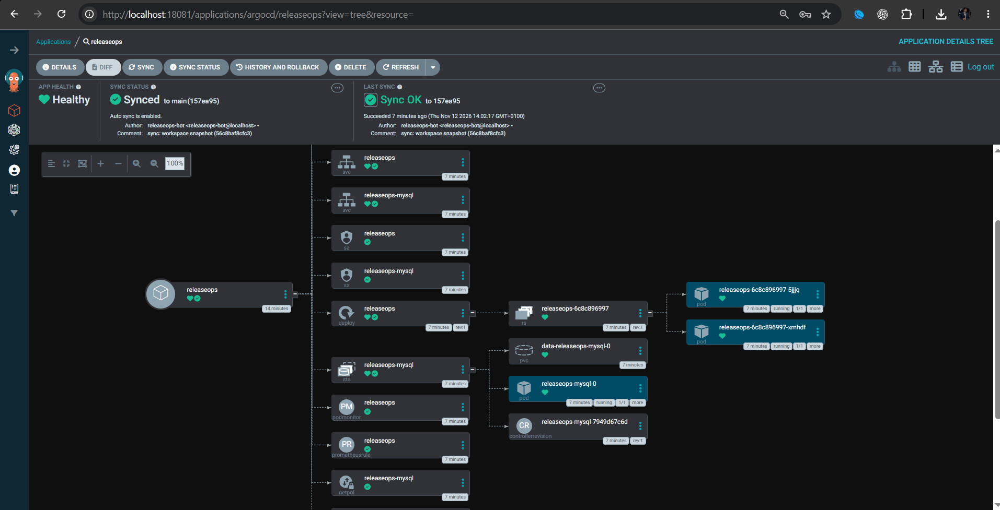
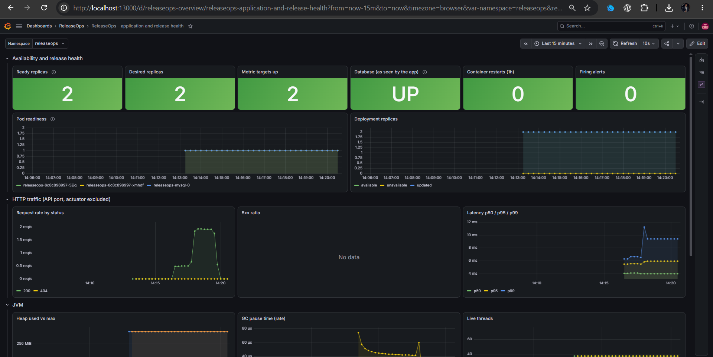
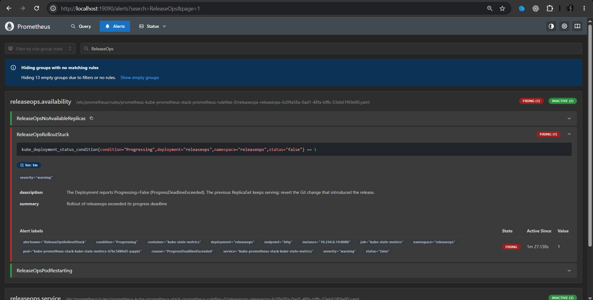
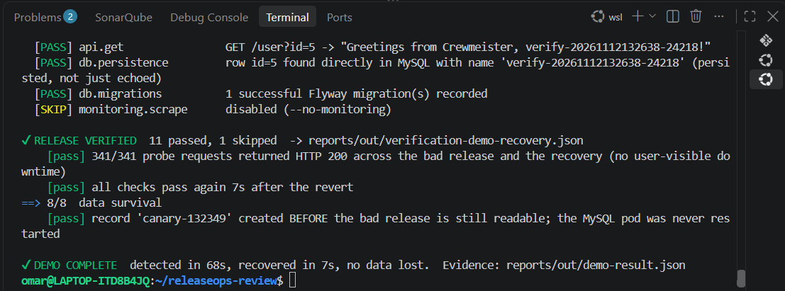
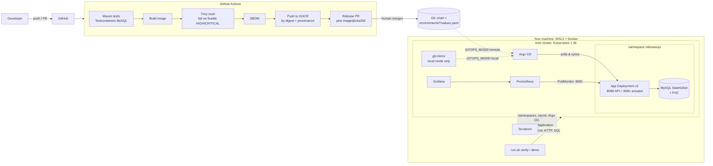

# ReleaseOps — reliable delivery, GitOps and release verification

[](https://github.com/OmarChouchane/releaseops/actions/workflows/ci.yml)

A Kubernetes delivery pipeline built around the Crewmeister DevOps challenge application (Spring Boot, MySQL, Flyway,
`GET/POST /user`). It builds, scans and ships an image, deploys it through **GitOps** (Argo CD), **verifies** that the
release really works, shows what happens when a release is **bad**, and recovers by reverting **Git**.

* Runs on a laptop: WSL2 + Docker + kind. No cloud account and no paid service.
* An independent implementation of the challenge. It does not describe Crewmeister's own infrastructure.
* The original challenge text is kept in [docs/CHALLENGE.md](docs/CHALLENGE.md).

## Status

| Verified by running it | Not verified |
|---|---|
| `./run.sh up` (12/12 release checks) and `./run.sh demo` on a local kind cluster; 15 tests; image scan; CI on GitHub | `GITOPS_MODE=remote` end to end; anything on AWS (`terraform validate` only); other machines or OSes; a full `up` since the folder restructure (CI and static checks pass) |

Details and numbers: [docs/results.md](docs/results.md). Limits: [docs/limitations.md](docs/limitations.md).

## Quick start

```bash
# WSL2 Ubuntu, Docker running, repository cloned inside WSL (e.g. ~/releaseops)
./run.sh up
./run.sh demo       # bad release, detection, Git rollback
```

`up` runs: checks → kind cluster and local registry → Terraform (namespaces, secrets, Argo CD, Prometheus/Grafana) → tests → image build → Trivy scan → SBOM → push by digest → commit the digest to the GitOps source → Argo CD sync → **release verification** → report.
Prerequisites and every command: [docs/runbooks/getting-started.md](docs/runbooks/getting-started.md).

### Five-minute reviewer guide
| Minute | Do | Look for |
|---|---|---|
| 0 | `./run.sh up` (**8 min** measured on a warm image cache; the very first run adds ≈10 min of downloads incl. the ≈3 GB scanner DB — start it before the clock) | `✔ RELEASE VERIFIED  … 12 passed`, then the URL list |
| 1 | `curl -s -X POST localhost:18080/user -H 'Content-Type: application/json' -d '{"name":"Ada"}' -i` then `curl -s 'localhost:18080/user?id=2'` | `Greetings from Crewmeister, Ada!` and a `Location: /user?id=2` header |
| 2 | Open Argo CD `http://localhost:18081` (password from `./run.sh status`) | Application `releaseops`: **Synced / Healthy**, source = the GitOps repo, image pinned by `@sha256:` |
| 3 | `./run.sh demo` (**≈3 min**; or read the recorded run in [docs/evidence/](docs/evidence/)) | drift reverted → bad commit pushed → **verification FAILS** with real diagnostics → the Prometheus alert **fires** → `git revert` → **verified again** → canary data still there |
| 4 | Open Grafana `http://localhost:13000` → *ReleaseOps – application and release health* | Replica/readiness dip during the demo, request rate, JVM, DB up |
| 5 | Read `reports/out/release-report.md` | One page of evidence: digest, tests, scan, SBOM, Argo state, every verification check |

**Argo CD** — the `releaseops` application is Synced and Healthy, deployed from the GitOps source:



**Grafana** — the ReleaseOps dashboard: replicas, database, traffic, latency, JVM and connection pool:



**Prometheus alert** — during the demo's bad release, `ReleaseOpsRolloutStuck` fires while the old pods keep serving:



**Demo result** — a bad release is detected, rolled back with `git revert`, and no data is lost:



---

## Architecture



Terraform owns the cluster add-ons and the Argo CD `Application`; Argo CD owns everything the Helm chart renders; the
image digest in `deploy/environments/*/values.yaml` is written only by the release process. More in
[docs/architecture.md](docs/architecture.md) and the [ADRs](docs/adr/).

## Repository layout

```
src/, pom.xml, Dockerfile        the application and its image (multi-stage, non-root, digest-pinned)
deploy/helm/releaseops/          Helm chart: app, MySQL, probes, NetworkPolicy, PodMonitor, alerts, dashboard
deploy/environments/{local,aws}/ values per environment (the image digest lives here)
deploy/git-mirror/              in-cluster git server used by the local demo
infra/terraform/modules/         reusable Terraform modules
infra/terraform/environments/    root configurations: local (kind) and aws (optional, never applied)
scripts/{setup,release,verify,lib,ci}/   the automation behind run.sh
tools/                           generator for the Grafana dashboard JSON
.github/                         workflows, Dependabot, CODEOWNERS, templates
docs/                            architecture, runbooks, ADRs, results, evidence
run.sh, Makefile                 the command-line entry point (Makefile is a thin wrapper)
```

## Commands

| Command | What it does |
|---|---|
| `./run.sh up` | Everything, end to end (safe to re-run) |
| `./run.sh deploy` | test → build → scan → SBOM → push → pin digest → Argo CD syncs |
| `./run.sh verify` | 12-check release verification; exit code 1 on failure |
| `./run.sh demo` | Drift, bad release, detection, Git rollback |
| `./run.sh status` / `logs` / `report` | Overview, logs, JSON and Markdown release report |
| `./run.sh validate` | Offline checks: shell, helm lint, terraform fmt and validate |
| `./run.sh cleanup --yes` | Delete only this project's cluster, registry and local state |

The full list is `./run.sh help`. Scripts use a dedicated kubeconfig, touch only `releaseops*` resources and listen on `127.0.0.1` only.

## Documentation

Start at the [documentation index](docs/README.md): architecture, runbooks, results, limitations and ADRs.

## Contributing and security

See [CONTRIBUTING.md](CONTRIBUTING.md) and [SECURITY.md](SECURITY.md). Changes are listed in [CHANGELOG.md](CHANGELOG.md).
