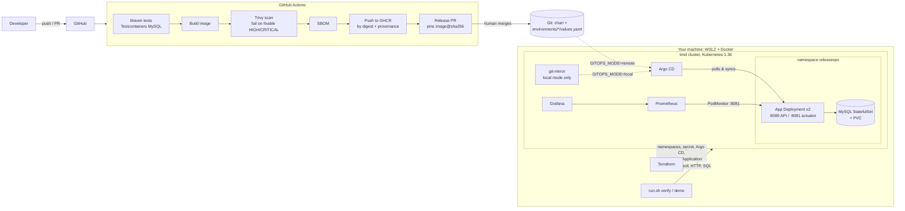

# Architecture

How the pieces fit: delivery flow, ownership boundaries, Terraform, CI, security, verification and monitoring.
Decisions and their trade-offs are recorded as [ADRs](adr/).

## Overview

### Who owns what
| Layer | Created by | Notes |
|---|---|---|
| kind cluster + local registry | `scripts/setup/cluster.sh` | Stage 0, outside Terraform on purpose (provider cycle) |
| Namespaces, DB Secret, Argo CD, Application/AppProject, kube-prometheus-stack, git mirror | **Terraform** (`infra/terraform/environments/local`) | Static kubeconfig + pinned context |
| Everything the Helm chart renders in `releaseops` | **Argo CD** | Terraform never touches it |
| Image digest in `values.yaml` | CI release PR (remote) / `./run.sh deploy` (local) | Never edited by hand |

### Delivery lifecycle
1. **Commit** application or chart changes.
2. **CI** runs tests (real MySQL), validates Helm/Terraform/shell, builds the image, scans it, generates an SBOM.
3. On `main`: the *exact scanned image* is pushed to GHCR, its **digest** is captured and provenance is attested.
4. CI opens a **release pull request** pinning `image@sha256:…`. A human merges it — that merge is the deploy decision.
5. **Argo CD** sees the new desired state and reconciles (auto-sync, prune, self-heal).
6. **Release verification** (`verify.sh`) proves the release works — Argo's "Healthy" is necessary, not sufficient.
7. Bad release? **Revert the Git commit**; Argo CD reconciles back; verify again.

Locally, steps 2–4 are done by `./run.sh deploy` against the same chart and the same verification (the image goes to a
local registry and the digest is committed to the git source Argo CD watches).

More: [ADR index](adr/) · [versions & sources](VERSIONS.md).

## Terraform design

See [ADR-0004](adr/0004-terraform-boundaries.md). In short:

* **Staged**: shell creates the cluster → Terraform connects by static kubeconfig path/context → manages namespaces,
  Secret, Argo CD, monitoring and the Argo `Application` → Argo CD manages the app. No provider depends on a resource of
  the same configuration; the `Application` is installed via a small Helm chart so a first `apply` needs no CRDs at plan time.
* **No overlap**: Terraform never renders the app chart; Argo CD can not create namespaces or cluster-scoped objects
  (`AppProject` whitelist is empty) and never sees the DB Secret's value.
* **Pinned**: providers `~> 3.3.0` (+ committed `.terraform.lock.hcl`, five platforms), chart versions as variables,
  `required_version >= 1.14`.
* **State**: local file in the git-ignored `.releaseops/` with mode 0600 — it holds generated passwords, so it is a
  secret. Use a remote encrypted, locked backend for anything shared (the AWS root shows the S3 block).
* `terraform fmt -check` and `validate` run in CI for both roots; no `local-exec` provisioners are used.

## CI pipeline (`.github/workflows/ci.yml`)

| Job | Runs on | Does |
|---|---|---|
| `test` | PR + main | `./mvnw verify` with real MySQL (Testcontainers); uploads surefire reports |
| `validate` | PR + main | `helm lint --strict` + render + `kubeconform`, `terraform fmt/validate` (modules, local, AWS), `bash -n`, `shellcheck`, `hadolint`, `actionlint` |
| `image` | PR + main | Build → **Trivy** (fail on fixable HIGH/CRITICAL) → **SBOM (Syft/SPDX)** → on `main` only: push the *same* image to GHCR, capture digest, sign provenance |
| `release-pr` | main only | Pins `image@sha256:…` in `deploy/environments/local/values.yaml` and opens a **pull request** |

Security properties: `permissions: {}` at the top and per-job grants; triggers are `pull_request` (never
`pull_request_target`) so fork code gets no token or secrets; the registry login/push/attest steps and the PR job are
`main`-only; no stored cloud keys (the optional AWS workflow uses GitHub OIDC, plan-only, manual); third-party
Actions pinned by **commit SHA** (see [VERSIONS.md](VERSIONS.md) for why); Dependabot updates actions, Maven,
Docker digests and Terraform.

**One-time repository setting:** *Settings → Actions → General → Allow GitHub Actions to create and approve pull
requests* (needed by `release-pr`, which uses only the built-in `GITHUB_TOKEN`).

## Security summary

* **Container**: non-root numeric uid, no capabilities, read-only root filesystem, `RuntimeDefault` seccomp, digest-pinned bases.
* **Namespaces** enforce Pod Security: `restricted` for the app, `baseline` for Argo CD/monitoring.
* **Secrets**: generated by Terraform, held in a Kubernetes Secret, never in Git, never in rendered manifests; MySQL
  root password is used only inside the MySQL pod; the app uses a least-privilege `app` user.
* **Network**: MySQL is ClusterIP-only with a NetworkPolicy (only app pods on 3306); actuator is on a separate port
  that is not in the Service; sensitive actuator endpoints are not exposed (tested).
* **Supply chain**: scan gate without blanket ignores (`.trivyignore.yaml` holds two narrowly scoped, justified, **expiring** exceptions — see below), SBOM, immutable digest references, provenance attestation, SHA-pinned Actions, reviewed release PRs.
* **Argo CD**: `AppProject` restricts source repo, destination namespace and forbids cluster-scoped kinds.
* Not done (and why): image signature *verification* at admission (needs a policy controller), Alertmanager receivers,
  TLS on loopback UIs, secrets management beyond a Kubernetes Secret (External Secrets/Vault is the production answer).

## Release verification

`./run.sh verify` is the acceptance gate ([ADR-0007](adr/0007-release-verification.md)). It checks, in order:
Argo CD sync (to the expected Git revision) → Argo CD health → expected image digest on the Deployment **and** on running
pods → rollout complete → pods Ready → no restart loop → actuator health incl. DB → `POST /user` → `GET /user?id=<new>` →
the row exists **in MySQL** (queried directly) → Flyway history → Prometheus scrapes every replica and `app_database_up=1`.
On failure it prints diagnostics (Argo conditions, Deployment conditions, container states, events, filtered logs) and a
heuristic likely cause. Exit code `0`/`1`, JSON in `reports/out/verification-<label>.json`. Skipped checks are listed as
skipped, never as passed.

## Monitoring

Prometheus + Grafana (kube-prometheus-stack, laptop-sized) — see [ADR-0008](adr/0008-observability.md).
The dashboard *ReleaseOps – application and release health* covers availability, HTTP rate/errors/latency, JVM, Hikari
connections, database health, pod readiness, restarts, CPU and memory. Six alert rules ship with the chart.
`./run.sh monitor` executes **every** dashboard query against the live Prometheus, lists loaded alert rules and confirms
Grafana imported the dashboard.

## Optional: AWS (EKS)

[`infra/terraform/environments/aws`](../infra/terraform/environments/aws/README.md): VPC (no NAT by default), EKS 1.36, managed nodes, EBS CSI via Pod
Identity, ECR with immutable tags, optional GitHub-OIDC role. The same chart is used with
`deploy/environments/aws/values.yaml`. **Validated offline only (`terraform init -backend=false`, `validate`, `fmt`);
never planned or applied against AWS.** Treat it as reviewed-but-unproven.
